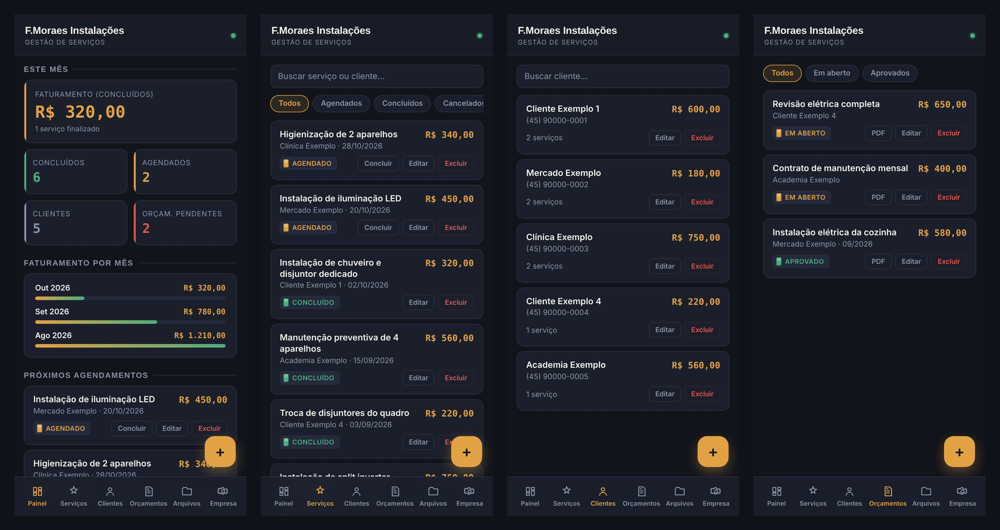

<h1 align="center">💰 Agenda-Financeira — Painel F.Moraes</h1>

  Sistema de gestão de serviços para prestadores autônomos: clientes, agenda, faturamento e orçamentos em PDF. 
  Criado para uso real na minha empresa de elétrica e climatização.

  
  
  
  

  

> Os dados mostrados são **fictícios**, apenas para demonstração.

## 🔧 O problema

Como eletricista e instalador de ar-condicionado, eu controlava serviços, clientes e orçamentos em papel e no bloco de notas do celular. Era difícil saber quanto faturei no mês, quais serviços estavam agendados e mandar um orçamento com aparência profissional.

## ✅ A solução

Um painel que roda no navegador do celular, sem instalação e sem servidor:

- **Painel:** faturamento do mês, histórico por mês, serviços concluídos e agendados, orçamentos pendentes
- **Serviços:** agenda com status (agendado, concluído, cancelado) e valor de cada serviço
- **Clientes:** cadastro com telefone e e-mail
- **Orçamentos:** criação, aprovação e **geração de PDF** com o logo da empresa, pronto para enviar no WhatsApp
- **Arquivos:** PDFs gerados ficam salvos no próprio app
- **Empresa:** dados que aparecem nos documentos (nome, CNPJ, contato)
- **Backup:** exporta e restaura todos os dados em um arquivo `.json`

## 🧱 Como funciona

| Parte | Como foi feita |
|---|---|
| Interface | HTML, CSS e JavaScript puro, pensada primeiro para celular |
| Armazenamento | `localStorage` do navegador: os dados ficam só no aparelho de quem usa |
| PDF | Biblioteca [jsPDF](https://github.com/parallax/jsPDF) |
| Hospedagem | GitHub Pages |

## ▶️ Como usar

1. Acesse **[moraesx3.github.io/minhas-financas](https://moraesx3.github.io/Agenda-Finaceira/)** ou baixe o `index.html` e abra no navegador.
2. O app abre com dados de exemplo. Para começar do zero com os seus dados, use **Empresa → Backup → Restaurar**, ou edite e exclua os exemplos.
3. Faça **backup** com frequência: os dados ficam salvos apenas no navegador.

## 🚧 Próximos passos

- [ ] Módulo de **PMOC**: cadastro de aparelhos de ar-condicionado e cronograma de manutenção
- [ ] Lembrete de clientes com manutenção vencendo
- [ ] Sincronização entre aparelhos

---

Feito por <a href="https://github.com/Moraesx3">Felipe Moraes</a> · Estudante de TADS · Eletricista e técnico em climatização · Corbélia/PR

